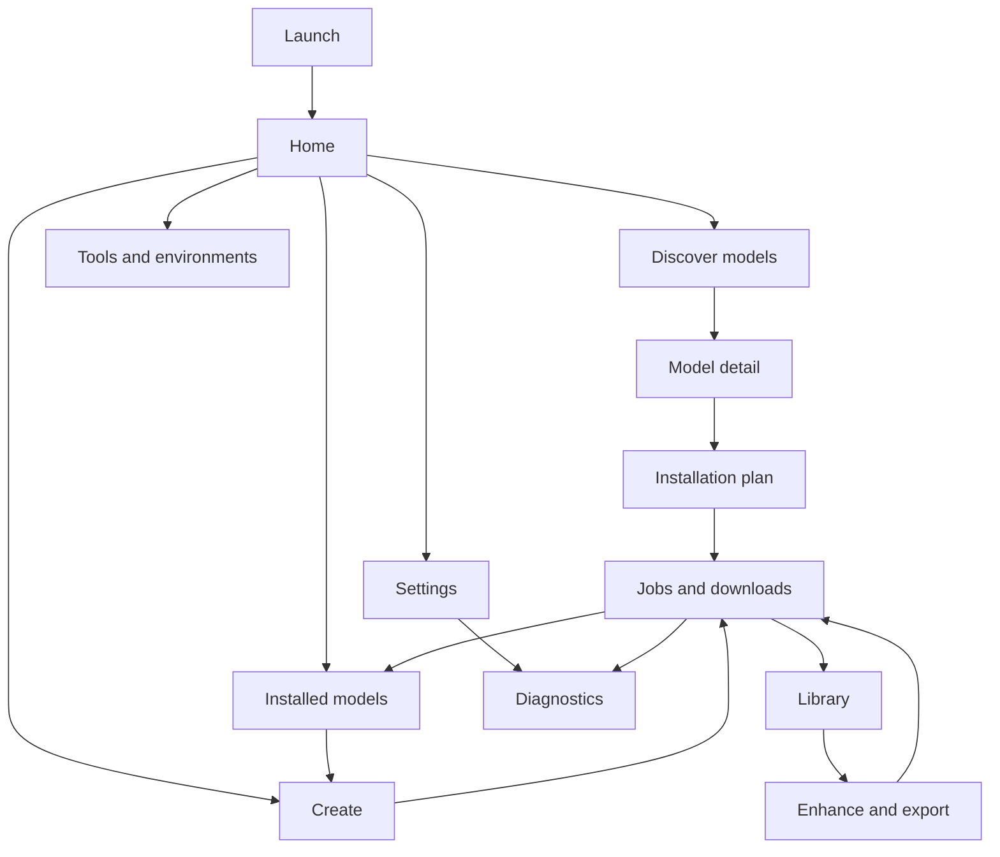
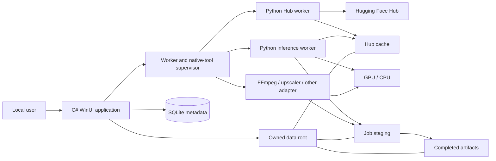
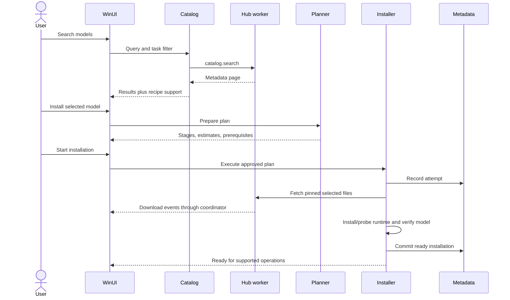
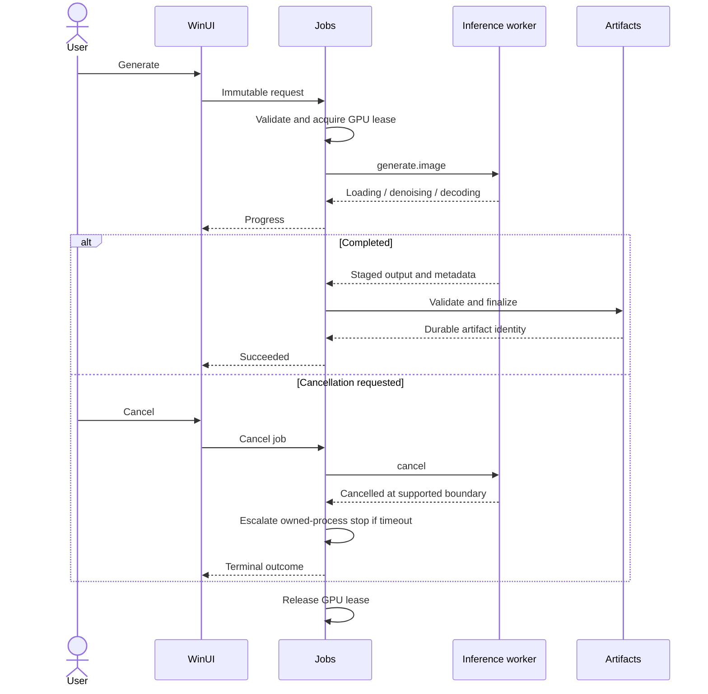
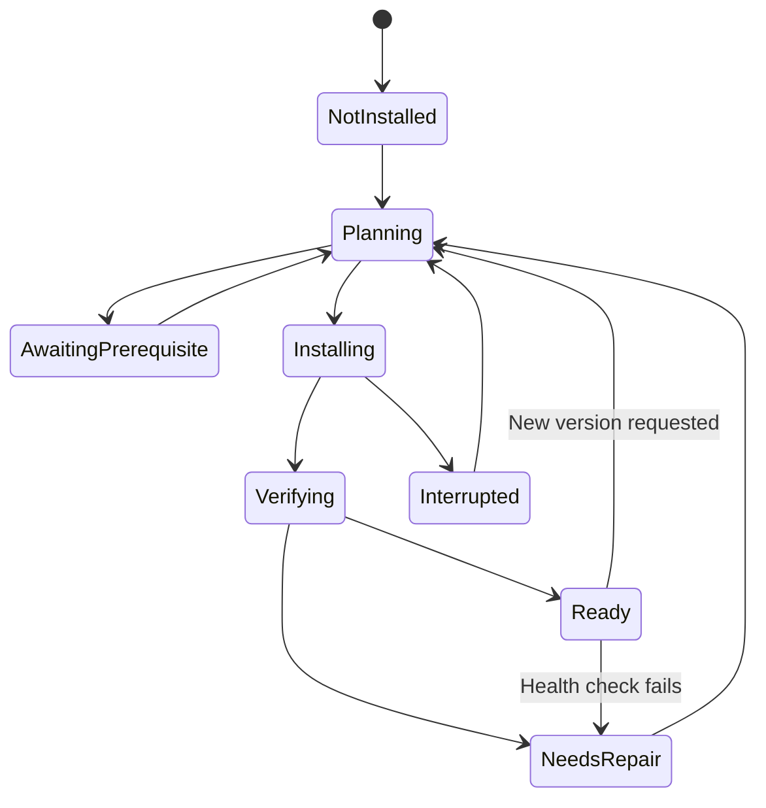
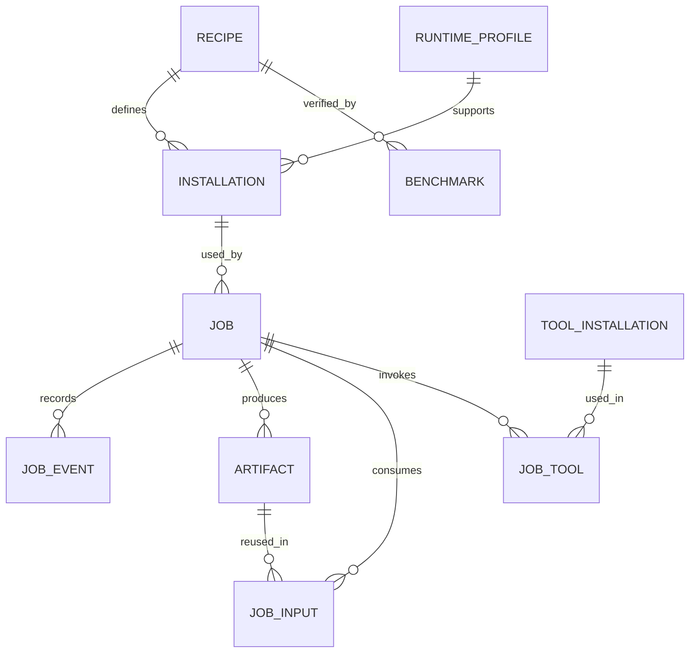

# Media Workbench — application map

17 October 2026 • proposed product and engineering map

This map connects the user interface, system components, operational flows, and scaffold. **Planned** means specified here but not implemented. **Scaffold** means the accompanying source contains the stated narrow behavior. The diagrams describe the target architecture unless labeled otherwise.

## 1. Product navigation



**Persistent shell:** left navigation, page heading, global activity indicator, and status access. Jobs survive navigation. Each detail screen has a stable back route. Start with one window; a second output preview window is optional later.

### Screen inventory

| Screen | Main content | Primary actions | Empty/error behavior | Scaffold |
|---|---|---|---|---|
| Home | Ready capabilities, recent work, setup state | Browse models; resume work | Show first actionable setup step | Overview and worker demonstration |
| Discover | Search, task filter, model cards | Search; open model | Cached results or clear network status | Local draft recipe catalog only |
| Model detail | Publisher, supported tasks, recipe, fit, license, files | Install; open source; select installed model | Explain unsupported/unknown/gated state | Recipe summary |
| Installation plan | Stages, runtime reuse, sizes, storage, prerequisites | Start; change storage | Identify blocking prerequisites | Plan preview; no installation |
| Installed | Ready/repairable installations, versions, disk references | Use; verify; repair; remove | Distinguish cache from ready installation | Planned |
| Create | Prompt, model, dimensions, seed, preview, advanced controls | Generate; cancel; reuse settings | Explain model/runtime prerequisites | Planned; generation explicitly unavailable |
| Enhance | Input media and task-specific processing controls | Upscale; interpolate; export | Unsupported input or missing tool | Planned |
| Jobs | Queue, stages, speed/elapsed, outcomes | Cancel; retry; inspect | Interrupted state on recovery | Live protocol events from one demo request |
| Library | Artifacts, previews, filters, provenance | Open; reuse; enhance; export | Import or create entry point | Planned |
| Tools | Managed/external tools, environments, health | Probe; install; repair | Explain ownership and capability | Architecture information |
| Settings | Storage, theme, account, resource policy | Select root; connect; manage | Invalid root/access state | Developer root/interpreter inputs |
| Diagnostics | Health probes, redacted logs, evidence | Run checks; export report | UI remains accessible if worker fails | Worker health via CLI; GUI diagnostic output |

Navigation labels reflect user tasks. Engine names belong in details and advanced controls unless selecting an engine is itself useful.

## 2. Proposed Create screen layout

```text
┌──────────────────────────────────────────────────────────────────────────┐
│ Media Workbench                              Activity: 1 job             │
├──────────────┬──────────────────────────┬─────────────────────────────────┤
│ Home         │ Create                   │ Preview                         │
│ Discover     │ Model [installed model]  │                                 │
│ Installed    │                          │        Selected result          │
│ Create       │ Describe your image      │                                 │
│ Enhance      │ [                      ] │                                 │
│ Jobs         │ [                      ] │                                 │
│ Library      │                          ├─────────────────────────────────┤
│ Tools        │ Size · Seed · Quantity   │ Recent results                  │
│              │ Advanced ▸               │ [thumbnail] [thumbnail] ...      │
│ Settings     │ [Generate]               │                                 │
├──────────────┴──────────────────────────┴─────────────────────────────────┤
│ Loading model / Generating 8 of 20 steps / Saving result       [Cancel]   │
└──────────────────────────────────────────────────────────────────────────┘
```

The first screen does not show package names, filesystem trees, or dependency graphs. The advanced panel provides effective configuration and reproducible request export. At narrow widths, preview and controls stack. Focus order follows inputs, action, progress, then results. Job progress is announced without repeatedly moving keyboard focus.

## 3. System context



Internet access is used for discovery, authentication checks, downloads, and selected updates. Generation uses local installed resources. Offline mode requires all referenced files already present. The app does not route generation to a cloud service as an automatic fallback.

## 4. Component and ownership map

| Component | Owns | Reads/calls | Must not own |
|---|---|---|---|
| WinUI views/view models | Presentation state and user input | Application interfaces | Package installation logic |
| Catalog service | Search projections and recipe association | Hub worker; registry | GPU model state |
| Recipe registry | Reviewed, versioned integration data | Bundled/catalog manifests | Arbitrary executable scripts |
| Compatibility evaluator | Evidence-based fit assessment | Hardware probes; recipe evidence | A universal guessed VRAM number |
| Installation planner | Typed steps and prerequisites | Registry; storage/runtime inventory | Direct UI behavior |
| Installation executor | Attempts, safe resume boundaries, readiness commit | Supervisor; Hub/runtime operations | User output deletion |
| Job coordinator | Durable state, queue, resource leases | Workers; native adapters; database | Tool-specific command syntax |
| Process supervisor | Process ownership, transport, timeout, cancellation | OS APIs | Domain readiness decisions |
| Python Hub adapter | Repository metadata, approved file downloads | HF SDK/cache | Application SQLite writes |
| Python inference adapter | Pipeline lifetime and model operations | Diffusers/PyTorch; installed snapshot | Catalog promotion decisions |
| Native adapter | Arguments, progress, output interpretation | Approved executable | Arbitrary shell execution |
| Artifact service | Validation, finalization, provenance | Job staging; library; database | Model cache garbage collection |
| Storage service | Root validation, space, owned-path policy | Filesystem; HF cache API | Deleting external folders |
| Credential service | Application-owned protected token | Windows protection facility | Logging credentials |

The C# composition root constructs these services. Core contracts keep the GUI and worker details independently replaceable.

## 5. Discovery-to-install flow



Prerequisites may include storage selection or access acceptance. A plan with an unresolved model revision or unverified runtime cannot execute as a supported installation. Cached model files remain useful after an environment failure, but do not make an installation ready.

## 6. Generation and cancellation



Cancellation is a state transition, not merely disabling a button. The final recorded outcome is authoritative. A result that already finalized may win a race with a late cancel. Production must not register a half-written file as a successful artifact.

## 7. Installation state map



Removal is a separately specified ownership-aware operation. It releases installation references before any selected cache cleanup. Its destructive behavior is not part of the initial scaffold.

## 8. Runtime/job states

| Entity | Main states | Durable? | Recovery rule |
|---|---|---|---|
| Runtime profile installation | Missing, provisioning, healthy, unhealthy | Yes | Verify actual environment before reuse |
| Worker | Stopped, starting, ready, busy, stopping, crashed | Session plus diagnostic history | Start a new owned worker; revalidate handshake |
| Job | Queued, preparing, running, finalizing, cancelling, succeeded, failed, cancelled, interrupted | Yes in target | Nonterminal attempt becomes interrupted after crash |
| Model installation | Not installed, installing, verifying, ready, needs repair | Yes | Reconcile cache + environment + evidence |
| Artifact | Staged, validated, finalized, missing | Yes in target | Missing files remain a visible repairable record |

The scaffold provides a domain job-state guard and real worker event handling. It does not implement the durable queue/database yet.

## 9. Data model



Database IDs reference immutable versions. Store large media and detailed logs in owned files. Store token references rather than tokens. Database schema migrations and backup are production milestones, not implied by this entity diagram.

## 10. Source tree

```text
scaffold/
  MediaWorkbench.slnx
  global.json
  Directory.Build.props
  NuGet.Config
  src/
    MediaWorkbench.App/             dark WinUI shell and composition
    MediaWorkbench.Core/            domain records, contracts, state guards
    MediaWorkbench.Infrastructure/  Python client, planner, tool process adapter
    MediaWorkbench.Cli/             direct access and diagnostic/demo runner
  workers/python/
    media_worker.py                 executable protocol entry point
  recipes/
    sd15-draft.json                 intentionally unverified example
  schemas/
    recipe.schema.json
    protocol.schema.json
  tests/
    MediaWorkbench.Checks/          real C# → Python integration checks
    test_worker.py                  Python protocol and input checks
  scripts/
    check.ps1
    run-desktop.ps1
```

Future worker modules will split Hub, generation, and hardware code as they become substantial. Do not split an 80-line entry point into many empty packages merely to match the diagram.

## 11. Implementation map and acceptance gates

| Feature | Concrete next implementation | Dependency | Acceptance evidence |
|---|---|---|---|
| Live model discovery | HF SDK search/detail handler plus UI binding | Lightweight Hub profile | Real public search, pagination, offline/error states |
| Storage | Root selector, free-space checks, ownership markers | Settings persistence | Reject invalid/nonwritable roots; relocation recovery |
| Account access | Protected token store and access status | Credential service | No credential in logs/args; gated/private fixture |
| Runtime bootstrap | `uv` resolver, exact lock and wheel sources | Storage/profile manifest | Reproducible target-machine install |
| Model installation | Pinned recipe and selected file fetch | Runtime + access | Restart/resume and verification failure cases |
| Generation | Versioned SD1.5 adapter | Verified installation | Valid image, peak VRAM/timing, cancel/OOM behavior |
| History/library | SQLite repository and artifact finalizer | Jobs + storage | Restart retains outputs and provenance |
| Native export | FFmpeg/ffprobe adapter | Approved binary identity | Correct media/audio/timing and cancellation |
| Enhancement | One upscaler adapter | Resource leases + tools | Visual fixture QA; memory/storage measurements |
| Video generation | One model/hardware recipe | Generation + export | Measured feasibility; no automatic hardware claim |
| Shipping | Installer, signing, runtime bootstrap distribution | Stable M1–M3 behavior | Clean-machine install/update/repair/uninstall |

## 12. The first complete vertical slice

1. Launch the GUI without an inference environment installed.
2. Choose a data root and search the public Hub.
3. Select one approved SD1.5 recipe and inspect the installation plan.
4. Install the locked runtime and pinned model, with visible progress.
5. Verify actual CUDA generation on the target machine.
6. Generate an image with saved settings and provenance.
7. Restart the app and find the image in Library.
8. Cancel another attempt and recover from an interrupted install.

This slice validates the proposed automation. Broad model support is built by adding verified recipes after this path works.

## 13. Reading order and authority

Use **01-Technical-Deep-Dive.md** for rationale and operational detail; this map for navigation and relationships; **03-Scaffold-Guide.md** for the actual runnable subset. When the diagram and code differ, the scaffold guide explicitly records what exists today. No mock screen, recipe draft, or protocol demonstration certifies a production feature.
